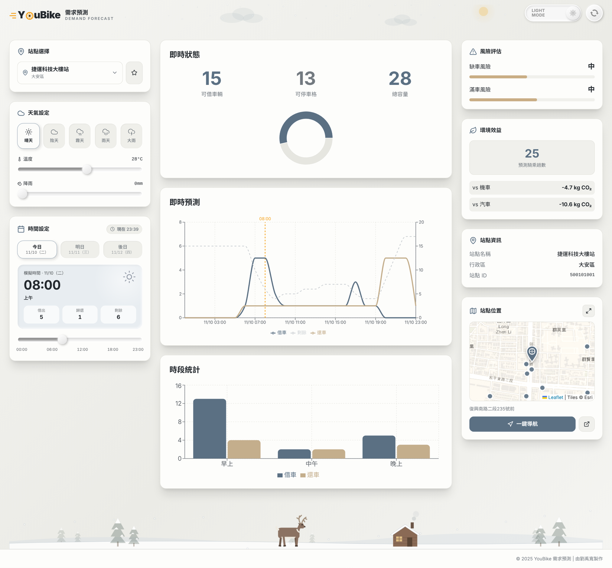
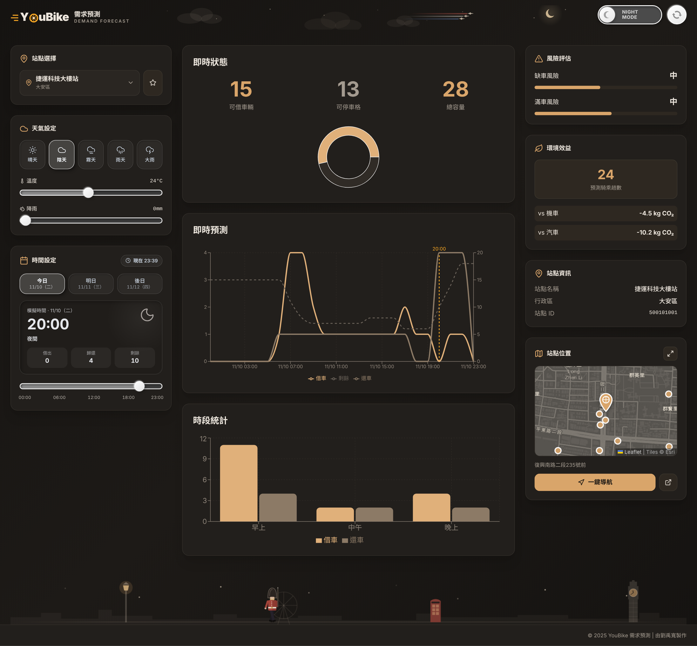
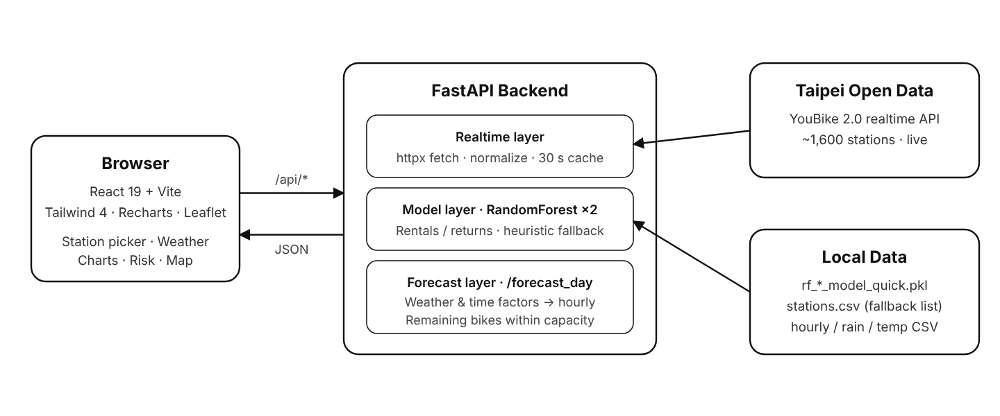

<div align="center">

[繁體中文](README.md) | **English**

# YouBike Predictor

**Hourly rental / return forecasting for Taipei YouBike 2.0 stations**




</div>

---

## Overview

Riders often arrive at a YouBike station to find no bikes, or no empty dock to return one. This project pulls **live station data from the Taipei City open-data API**, predicts **hourly rentals and returns** for any of ~1,600 stations with a **RandomForest** model (station, hour, weekday, rain, temperature), and **simulates the remaining bike count hour by hour** from the current live inventory — so you can see *when* a station is likely to run empty or fill up.

## Features

- Live bikes / empty docks / capacity per station
- Hourly forecast for today / tomorrow / the day after
- Timeline slider: the sky panel changes with the time of day and shows that hour's prediction
- Remaining-bike simulation bounded by dock capacity
- Weather what-if: presets (sunny / cloudy / foggy / rain / heavy rain) plus temperature and rain sliders
- Stock-out and full-station risk levels
- CO₂ savings estimate vs scooter / car
- Favorite stations (saved in the browser)
- Light (Nordic · Lapland) and dark (warm charcoal · London) themes with animated scenes
- Themed station picker: search, district chips, favorites first, keyboard navigation
- Station map with nearby stations and one-tap Google Maps navigation
- Falls back to local CSV / heuristics if the API or model is unavailable

## Architecture



### How the forecast works

1. **Model flow** — RandomForest predicts rentals and returns for each hour from `station_id, district, docks_total, hour, weekday, is_peak, rain_mm, is_rain, temp_C`.
2. **Scenario factors** — the prediction is multiplied by rain, temperature-comfort (20–28 °C), time-of-day and weekend factors.
3. **Inventory simulation** — starting from the live bike count, each hour: rentals ≤ bikes on site, returns ≤ empty docks, and flows taper off when the station is below 30 % bikes or 30 % empty docks.

## Quick Start (Windows)

Only **Python 3.10+** is required — the pre-built web UI (`frontend/dist`) is served by the backend.

```bat
:: 1. First-time setup: creates venv\ and installs packages
setup.bat

:: 2. Start; opens the browser automatically
start.bat

:: 3. Stop everything
stop.bat
```

| Service | URL |
|---|---|
| Web dashboard | http://127.0.0.1:8000 |
| API docs (Swagger) | http://127.0.0.1:8000/docs |

**Frontend development** — with Node.js 18+ installed, `setup.bat` also installs the frontend packages and `start.bat` runs the Vite dev server with hot reload at http://localhost:5173. Run `npm run build` in `frontend/` to refresh `dist/`.

If [`cloudflared`](https://developers.cloudflare.com/cloudflare-one/connections/connect-networks/downloads/) is installed, `start.bat` also opens a temporary public URL for demos.

<details>
<summary>macOS / Linux (manual)</summary>

```bash
python3 -m venv venv && source venv/bin/activate
pip install -r backend/requirements.txt
cd backend && uvicorn main:app --port 8000        # → http://127.0.0.1:8000
```
</details>

## API

| Method | Path | Description |
|---|---|---|
| GET | `/health` | Health check (is the model loaded?) |
| GET | `/stations?source=api\|csv` | Station list |
| GET | `/realtime/{station_id}` | Live status of one station |
| GET | `/stations/search?q=` | Search by name / ID |
| POST | `/predict_one` | Single-hour prediction |
| POST | `/forecast_day` | Windowed forecast + remaining bikes |

Set `YOUBIKE_URL` to point the backend at a saved JSON snapshot for offline demos.

```bash
curl -X POST http://127.0.0.1:8000/forecast_day \
  -H "Content-Type: application/json" \
  -d '{"station_id": 500101001, "view": "next6", "rain_mm": 0, "temp_c": 26}'
```

## Project Structure

```
youbike-predictor/
├── backend/
│   ├── main.py              # FastAPI app: live API, model, forecast logic
│   ├── fetch_realtime.py    # (optional) archive live data into MySQL
│   └── requirements.txt
├── frontend/                # React 19 + Vite + Tailwind 4 + Recharts
│   ├── src/App.jsx          # dashboard UI
│   └── dist/                # pre-built UI served by the backend
├── data/
│   ├── stations.csv         # station list fallback
│   ├── youbike_hourly_sim.csv   # hourly training data (simulated)
│   ├── rain.csv / temp.csv  # hourly weather features
├── rf_rent_model_quick.pkl  # trained rental model
├── rf_return_model_quick.pkl# trained return model
├── setup.bat / start.bat / stop.bat
└── docs/                    # screenshots & diagram
```

## Limitations

- The bundled training set is **simulated hourly data for one day** across all stations, so the model learns hour/station patterns but not long-term seasonality. `fetch_realtime.py` can collect real data for retraining.
- Weather is user-supplied, not yet pulled from the Central Weather Administration API.
- Covers Taipei City only (New Taipei uses a different API).

## Author

**Yu-Kuan Liu** — Dept. of Electronic Engineering, National United University
