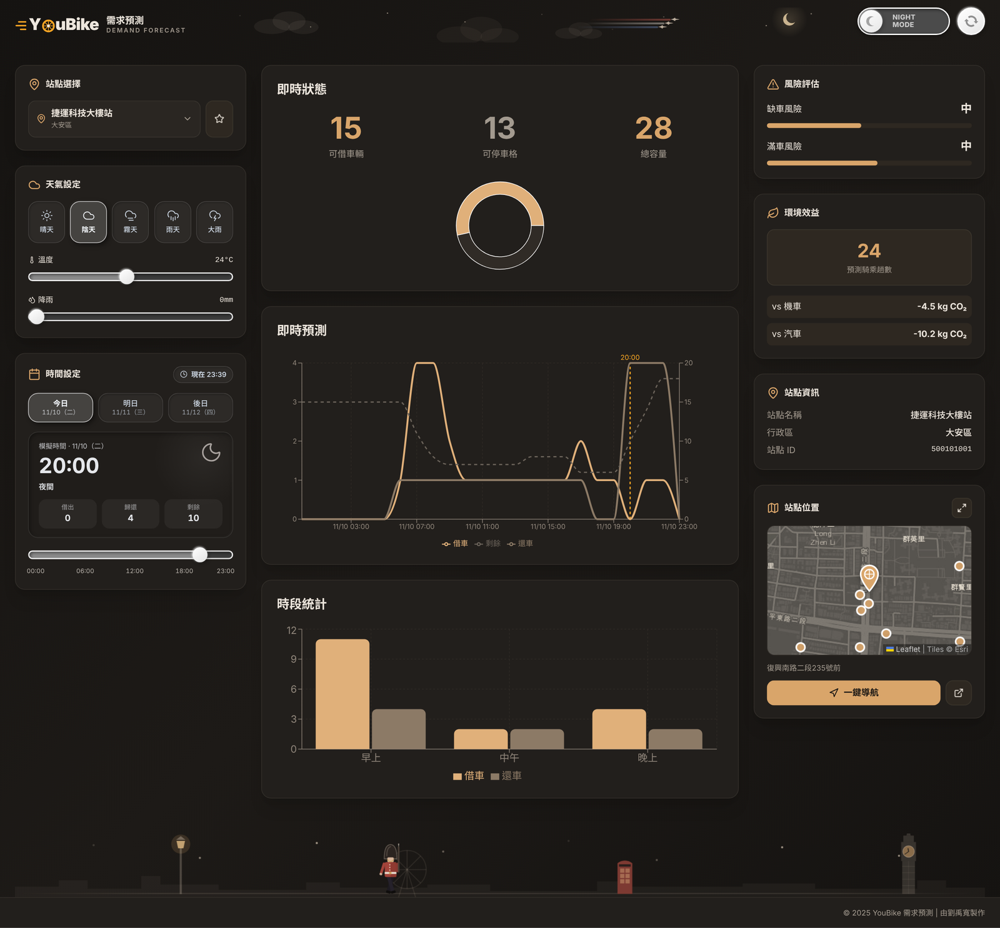
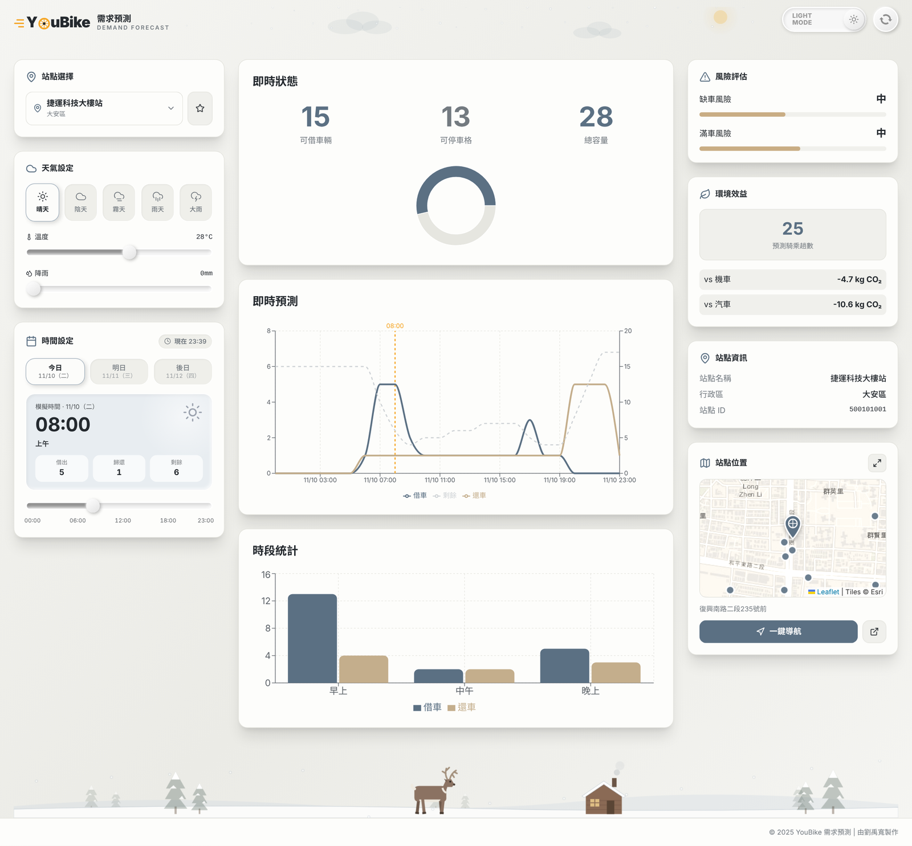
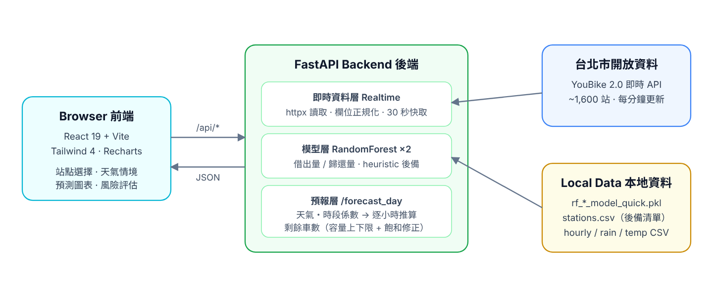

<div align="center">

# 🚲 YouBike Predictor

**Taipei YouBike 2.0 hourly rental / return forecasting with machine learning**<br>
**台北市 YouBike 2.0 站點借還車量預測系統**

🏆 3rd Place — 18th Information Education Conference (第十八屆資訊教育研討會 第三名)




</div>

---

## Overview｜專案簡介

**EN** — Riders often arrive at a YouBike station to find no bikes, or no empty dock to return one. This project pulls **live station data from the Taipei City open-data API**, predicts **hourly rentals and returns** for any of ~1,600 stations with a **RandomForest** model (station, hour, weekday, rain, temperature), and **simulates the remaining bike count hour by hour** from the current live inventory — so you can see *when* a station is likely to run empty or fill up.

**中文** — 騎 YouBike 最怕到了站卻「沒車可借」或「沒位可還」。本系統串接**台北市政府 YouBike 2.0 即時開放資料**，以 **RandomForest** 模型（站點、時段、星期、降雨、氣溫）預測全市約 1,600 個站點的**每小時借出量與歸還量**，再以**目前即時車數為起點逐小時推算剩餘車數**，讓使用者提前知道哪個時段可能缺車或滿站。

## Features｜功能

| | EN | 中文 |
|---|---|---|
| 📡 | Live bikes / empty docks / capacity per station | 即時可借車數、可停車格、總容量 |
| 📈 | 6h / 12h / today / tomorrow / day-after forecast | 6 小時、12 小時、今日、明日、後日預測 |
| 🔋 | Remaining-bike simulation bounded by dock capacity | 依車柱容量上下限推算剩餘車數 |
| 🌧️ | Weather what-if: presets + rain / temperature sliders | 天氣情境模擬（晴／陰／小雨／大雨＋滑桿） |
| ⚠️ | Stock-out & full-station risk levels | 缺車／滿車風險等級 |
| 🌱 | CO₂ savings estimate vs scooter / car | 相較機車、汽車的 CO₂ 減量估算 |
| ⭐ | Favorite stations (saved in browser) | 常用站點（存在瀏覽器） |
| 🌗 | Dark / light theme | 夜間／日間主題 |
| 🛟 | Falls back to local CSV / heuristic if API or model is unavailable | API 或模型不可用時自動改用本地資料／經驗公式 |



## Architecture｜系統架構



### How the forecast works｜預測流程

1. **Model flow 模型流量** — RandomForest predicts rentals & returns for each hour from `station_id, district, docks_total, hour, weekday, is_peak, rain_mm, is_rain, temp_C`.<br>
   以 RandomForest 預測每個整點的借出與歸還量。
2. **Scenario factors 情境係數** — multiplied by rain, temperature-comfort (20–28 °C), time-of-day and weekend factors.<br>
   再乘上降雨、溫度舒適度、時段、週末係數。
3. **Inventory simulation 剩餘車數推算** — starting from the live bike count, each hour: rentals ≤ bikes on site, returns ≤ empty docks, and flows taper off when the station is below 30 % bikes or 30 % empty docks.<br>
   以即時車數為起點，借出不超過現有車數、歸還不超過空位，低於容量 30% 時流量遞減。

## Quick Start｜快速開始（Windows）

Only **Python 3.10+** is required — the pre-built web UI (`frontend/dist`) is served by the backend.<br>
只需要 **Python 3.10 以上**；打包好的網頁（`frontend/dist`）由後端直接提供，不必安裝 Node.js。

```bat
:: 1. First-time setup: creates venv\ and installs packages
::    第一次安裝：建立 venv 並安裝套件
setup.bat

:: 2. Start; opens the browser automatically　啟動，會自動開啟瀏覽器
start.bat

:: 3. Stop everything　關閉所有服務
stop.bat
```

| Service | URL |
|---|---|
| Web dashboard 網頁 | http://127.0.0.1:8000 |
| API docs (Swagger) 後端文件 | http://127.0.0.1:8000/docs |

**Frontend development 前端開發** — with Node.js 18+ installed, `setup.bat` also installs the frontend packages and `start.bat` runs the Vite dev server with hot reload at http://localhost:5173. Run `npm run build` in `frontend/` to refresh `dist/`.<br>
若有安裝 Node.js 18+，`setup.bat` 會一併安裝前端套件，`start.bat` 會改開 Vite 熱更新（http://localhost:5173）；修改前端後在 `frontend/` 執行 `npm run build` 更新 `dist/`。

If [`cloudflared`](https://developers.cloudflare.com/cloudflare-one/connections/connect-networks/downloads/) is installed, `start.bat` also opens a temporary public URL for demos.<br>
若有安裝 cloudflared，`start.bat` 會另外開一個臨時外網網址，方便現場展示。

<details>
<summary>macOS / Linux (manual)</summary>

```bash
python3 -m venv venv && source venv/bin/activate
pip install -r backend/requirements.txt
cd backend && uvicorn main:app --port 8000        # → http://127.0.0.1:8000
```
</details>

## API

| Method | Path | Description 說明 |
|---|---|---|
| GET | `/health` | Health check, model loaded? 健康檢查 |
| GET | `/stations?source=api\|csv` | Station list 站點清單 |
| GET | `/realtime/{station_id}` | Live status of one station 單站即時資料 |
| GET | `/stations/search?q=` | Search by name / ID 站名站號搜尋 |
| POST | `/predict_one` | Single-hour prediction 單一時間點預測 |
| POST | `/forecast_day` | Windowed forecast + remaining bikes 視窗預報＋剩餘車數 |

```bash
curl -X POST http://127.0.0.1:8000/forecast_day \
  -H "Content-Type: application/json" \
  -d '{"station_id": 500101001, "view": "next6", "rain_mm": 0, "temp_c": 26}'
```

## Project Structure｜專案結構

```
youbike-predictor/
├── backend/
│   ├── main.py              # FastAPI app: live API, model, forecast logic
│   ├── fetch_realtime.py    # (optional) archive live data into MySQL
│   └── requirements.txt
├── frontend/                # React 19 + Vite + Tailwind 4 + Recharts
│   ├── src/App.jsx          # dashboard UI
│   └── dist/                # pre-built UI served by the backend
├── data/
│   ├── stations.csv         # station list fallback
│   ├── youbike_hourly_sim.csv   # hourly training data (simulated)
│   ├── rain.csv / temp.csv  # hourly weather features
├── rf_rent_model_quick.pkl  # trained rental model
├── rf_return_model_quick.pkl# trained return model
├── setup.bat / start.bat / stop.bat
└── docs/                    # screenshots & diagram
```

## Limitations｜限制與未來改進

- The bundled training set is **simulated hourly data for one day** across all stations, so the model learns hour/station patterns but not long-term seasonality. `fetch_realtime.py` can collect real data for retraining.<br>
  目前內附的訓練資料為**單日的模擬逐時資料**，可學到時段與站點差異，但無法反映長期季節性；可用 `fetch_realtime.py` 累積真實資料後重新訓練。
- Weather is user-supplied, not yet pulled from the Central Weather Administration API.<br>
  天氣目前由使用者輸入，尚未串接中央氣象署 API。
- Covers Taipei City only (New Taipei uses a different API).<br>
  目前僅支援台北市站點。

## Author｜作者

**劉禹寬 Yu-Kuan Liu** — Dept. of Electronic Engineering, National United University 國立聯合大學 電子工程學系

> For competition / educational use. Predictions are not guaranteed to be accurate.<br>
> 本專案為競賽與教學用途，不保證預測準確性。
